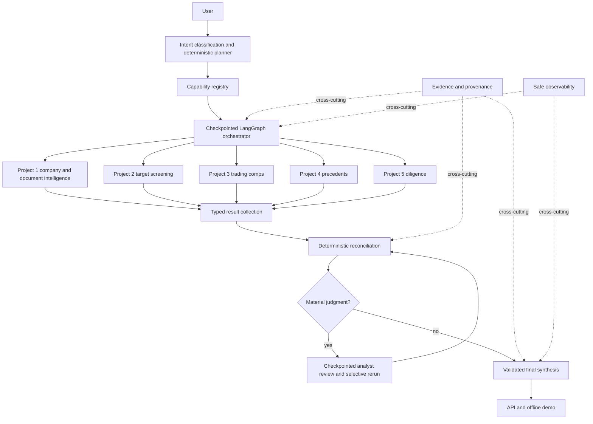

# Project 6 Final V1

## Final architecture



## Final synthesis

`SynthesisService` consumes only `DealState`, `ReconciliationResult`, capability outcomes, and
recorded warnings. It first builds immutable structured sections, valuation entries, material
metrics, assessment policy facts, lineage source IDs, and rendered citations. A narrative provider
is optional. Structured values remain authoritative.

The output covers deal overview, strategic rationale, company intelligence, target screening,
trading comps, precedents, diligence, unified valuation, scenarios, reconciliation issues,
diligence implications, risks, analyst decisions, questions, assumptions, and limitations.
Projects 3 and 4 remain separate methods; no automatic blend is calculated.

`DealAssessment` is one of `ATTRACTIVE`, `ATTRACTIVE_WITH_CONDITIONS`, `MIXED`, `HIGH_RISK`, or
`INSUFFICIENT_INFORMATION`. The policy uses target and specialist coverage, failed capabilities,
unresolved issues, and high or critical risks. The output lists its policy reasons and counts. It
supports analyst judgment and is not an investment recommendation.

## Numerical and narrative controls

Before publication, every surfaced valuation low, midpoint, and high and every material EBITDA,
working-capital, net-debt, or customer-concentration value is compared with the canonical source
object. Unknown evidence IDs are not rendered. A mismatch raises `SynthesisValidationError` and
blocks output.

An optional narrative provider receives a bounded structured summary. `SynthesisGuard` rejects new
numeric mentions that are absent from the allowed structured values. Project 6 never asks the model
to calculate or rewrite a specialist value. Entity and risk generation remains bounded to the
structured sections supplied by deterministic code.

## Evidence and citations

Each synthesis item carries source artifact IDs and evidence IDs. `CitationRenderer` formats only
known `EvidenceReference` fields and retains pages, sections, spreadsheet sheets, cell ranges,
rows, chunks, record IDs, and source project identity. The trace is:

`final output -> synthesis item -> specialist/reconciliation ID -> evidence ID -> native locator`.

## Observability

`build_run_summary` reports run duration, node durations, invocations, skips, retries, failures,
reconciliation issues, reviews, reruns, evidence, warnings, errors, capability outcomes, final
status, and assessment. `safe_trace` returns identifiers, event type, timestamp, status, capability,
result, retry, branch, and duration. It excludes free-form messages, prompts, excerpts, VDR content,
keys, and chain of thought.

## API

The local FastAPI application exposes:

| Endpoint | Purpose |
| --- | --- |
| `GET /health` | Offline service health and version |
| `POST /deal-intelligence/runs` | Create and synchronously advance a checkpointed run |
| `GET /deal-intelligence/runs/{run_id}` | Typed progress, capability, review, warning, and error status |
| `POST /deal-intelligence/runs/{run_id}/review` | Validate a decision and resume the same checkpoint |
| `POST /deal-intelligence/runs/{run_id}/resume` | Equivalent explicit resume endpoint |
| `GET /deal-intelligence/runs/{run_id}/result` | Validated structured final output, or `409` while unavailable |
| `GET /deal-intelligence/runs/{run_id}/trace` | Safe operational trace |

V1 is offline only. Pydantic rejects extra fields and live mode. Unknown runs return `404`, invalid
reviews return `400`, non-resumable runs and unavailable results return `409`. Responses do not
include stack traces.

Run locally:

```powershell
python -m uvicorn ma_deal_intelligence.api:app --reload
```

## Projects 1–5 integration

| Specialist | Actual adapter boundary and handoff |
| --- | --- |
| Project 1 | `Project1Adapter` maps canonical company/document requests to injected native services or deterministic fixtures, then returns document IDs, research profile IDs, cited answer IDs, metrics, and evidence. |
| Project 2 | `Project2Adapter` maps acquisition criteria to source/screen requests and returns ranked canonical candidates with score, eligibility, rationale, and evidence. |
| Project 3 | `Project3Adapter` maps target identity, period, currency, and input metrics and returns exact peer IDs, financial metrics, and trading-comps valuations. |
| Project 4 | `Project4Adapter` maps target/sector/date context and returns exact selected transaction IDs, value bases, metrics, precedent valuations, evidence, and warnings. |
| Project 5 | `Project5Adapter` maps target, engagement, and VDR references and returns typed diligence findings, adjusted financial metrics, missing-information IDs, conflict IDs, and review state. |

Adapters use fixture mode by default and accept injected native callables. Project 6 does not import
private specialist modules or reproduce specialist calculations.

## Security and configuration review

Offline mode needs no secrets; `.env.example` says so explicitly. No key or credential is stored in
the project. The API has no debug exception route. The public trace omits messages and excerpts.
Checkpoints and the API registry are process-local and intended for one trusted local process. V1
has no authentication, authorization, tenant boundary, encrypted persistence, or production VDR
connector.

## Limitations

- Evaluation is deterministic and synthetic-heavy.
- Native specialist services require explicit injection; fixture mode is the integrated default.
- Checkpoints and API run records are process-local and disappear at process exit.
- The API has no authentication, enterprise permissions, rate limiting, or deployment configuration.
- Market data freshness follows specialist inputs and has no real-time guarantee.
- Project 6 does not provide full legal, tax, cyber, DCF, LBO, or accretion/dilution analysis.
- There is no banker-grade Excel, PowerPoint, PDF, or full web interface.
- Observability is a typed in-process summary rather than a production telemetry backend.
- The policy assessment supports human judgment and is not investment advice.

## Future production hardening

Use durable encrypted checkpoint and run stores, per-deal access control, audit retention, secrets
management, production data connectors, larger human-labeled evaluations, model and prompt version
tracking, distributed execution, telemetry export, and a reviewed analyst UI before real deal use.
