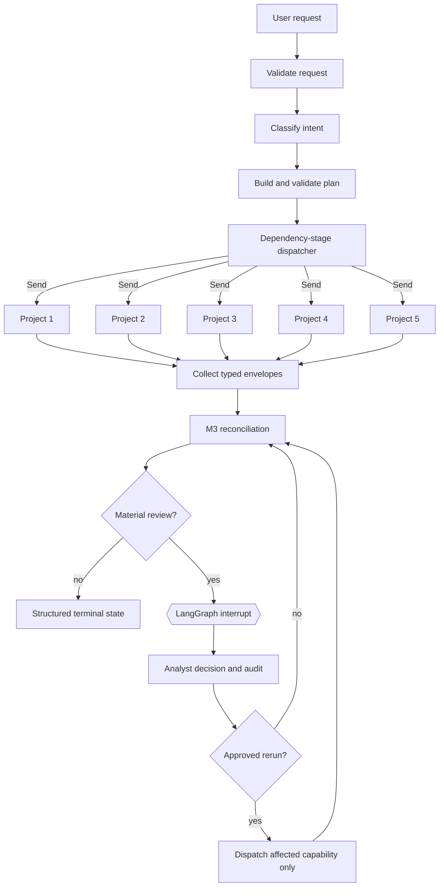

# LangGraph Orchestration, Human Review, and Resilience

M4/5 composes the M1/2 classifier, planner, registry, adapters, and ingestion service with the M3
reconciliation service. LangGraph controls transitions and checkpoints. Projects 1–5 retain all
domain calculations.

## Runtime flow

## Typed graph state

`GraphState` retains the run and thread IDs, user request, intent classification, validated plan,
canonical `DealState`, per-capability status and transition history, specialist attempts,
reconciliation result, retry counters, review state and history, clarification state, warnings,
errors, compact trace events, and a structured terminal result. Tuple and mapping reducers merge
parallel worker updates by stable IDs.

The runtime does not store documents, secrets, prompts, stack traces, or private model reasoning in
its trace. It stores references, safe error details, and concise operational rationale.

## Dynamic dispatch and dependencies

The dispatcher reads the planner's topological stages. Each stage checks dependency completion and
uses LangGraph `Send` for its ready capabilities. Same-stage Project 3 and Project 4 calls therefore
fan out and join at one result collector. Later stages start only after the collector has ingested
the prior stage. Failed dependencies cause a structured skip rather than an unsafe downstream call.

Capabilities absent from the validated plan are never dispatched. The milestone evaluation harness
compares adapter invocations with planned capabilities and reports an unnecessary-call rate.

## Status and result ingestion

Each capability records `NOT_STARTED`, `READY`, `RUNNING`, `COMPLETED`,
`COMPLETED_WITH_WARNINGS`, `BLOCKED`, `FAILED`, or `SKIPPED` transitions. Successful adapters return
the existing typed `ProjectResultEnvelope`; `ingest_result` preserves source ownership, evidence,
schema version, warnings, errors, run IDs, prior versions, and supersession metadata.

Exact project/capability/run duplicates remain no-ops. A rerun uses a new deterministic execution
ID and keeps the earlier envelope.

## Failure policy and retries

Failures are classified as retryable, blocking, nonblocking, or human-resolvable. Timeouts,
connection errors, and explicit transient adapter failures receive bounded retries. The default is
two total attempts. Validation and contract errors are not retried. Every failed attempt remains in
the error history and trace.

A failed specialist does not remove completed results from independent specialists. Available
outputs still reach M3 reconciliation. Runs with useful surviving output terminate with warnings;
runs with no useful output fail.

## Reconciliation and staleness routing

The graph calls `ReconciliationService.reconcile` and `apply_staleness`; it contains no duplicate
metric or valuation logic. Snapshot issues, stale outputs, recomputation requests, review items,
scenarios, and open questions remain in the typed reconciliation result.

Material recomputation requests require an analyst decision. Selecting the adjusted or both-scenario
path dispatches only the affected registered capability. The adapter produces the new result;
Project 6 does not edit EBITDA, valuation, multiple, net debt, QoE, or precedent values.

## Human review and resume

Material EBITDA basis conflicts, stale valuation inputs, material unresolved diligence findings,
conflicting evidence, and other M3 review items can create an `AnalystReviewRequest`. The payload
contains conflicting values, affected outputs, evidence IDs, and bounded actions. `interrupt`
checkpoints the complete state before waiting.

Resume uses the same `thread_id` with `Command(resume=...)`. The selected action produces append-only
`AnalystDecision` and `ReviewAuditEvent` records. Audit records contain the previous state, available
actions, selected action, rationale, reviewer, timestamp, and resulting action. Deterministic review
IDs stop repeated resumes from duplicating events.

Multiple review events are supported sequentially. The default maximum is four. At the limit, the
run retains unresolved issues and completes with warnings instead of looping indefinitely.

User clarification remains separate from analyst review. Missing target, documents, financials,
currency, or sector context produces `WAITING_FOR_INPUT` with typed requirements and suggested
questions before any unsafe specialist invocation.

## Checkpointing and identifiers

The V1 default is LangGraph `InMemorySaver` with a trusted, same-process pickle serializer. Stable
thread IDs isolate checkpoint streams, and stable run IDs identify trace and review records. The
application rejects reuse of a thread that already contains state. Production deployments must
inject a durable secured checkpointer with tenant isolation, encryption, retention, and safe
serialization controls.

## Terminal states

The runtime returns `COMPLETED`, `COMPLETED_WITH_WARNINGS`, `PARTIALLY_COMPLETED`,
`WAITING_FOR_INPUT`, `REVIEW_REQUIRED`, `FAILED`, or `CANCELLED` as applicable. A terminal result
lists completed, failed, and skipped capabilities and indicates whether the state is ready for the
future M6/7 synthesis stage.

## Invariants and numerical integrity

Before terminal completion the runtime checks that specialist envelopes retain source project and
evidence, canonical metric and valuation values equal their specialist payloads, material reruns
have an analyst approval, and a clean `COMPLETED` state hides no errors. Recalculation belongs to the
specialist adapter target.

## Offline evaluation

All graph tests use deterministic adapter fixtures. `GraphEvaluationHarness` measures routing,
dependency order, branch correctness, review and resume behavior, partial-failure survival, and
unnecessary calls. It is a milestone harness; the full evaluation and observability suite belongs
to M6/7.

## Limitations

- The included checkpointer is process-local and trusted-environment only.
- Fixture reruns demonstrate versioned workflow behavior; native adapters must support the approved
  scenario input to calculate a changed valuation.
- There is no cross-process worker queue, distributed cancellation, production persistence, final
  narrative, API, frontend, or deployment layer.
- LangChain is used only transitively by LangGraph's runnable interface. It is not a competing
  orchestration layer.
