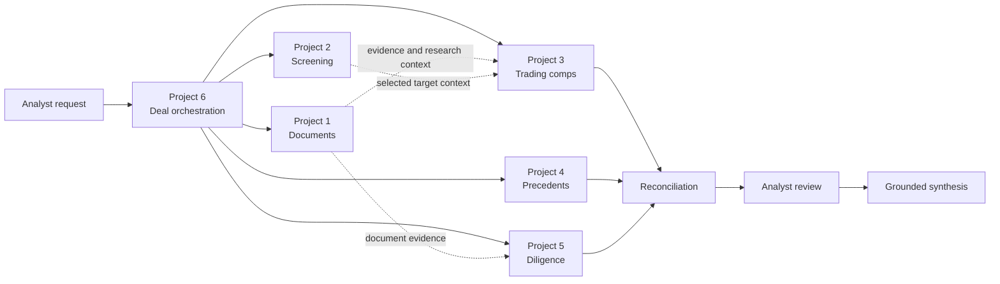

# AI × M&A Deal Intelligence Portfolio

Six connected Python systems model an M&A workflow from source documents and target screening
through valuation, diligence, and deal-level synthesis. The portfolio emphasizes deterministic
finance, traceable evidence, explicit human review, and honest offline evaluation.

This is an educational Version 1 portfolio. It is not investment advice, a production VDR, or an
autonomous transaction decision system.

## Portfolio architecture

| # | System | Business purpose | Implemented boundary |
| --- | --- | --- | --- |
| 1 | [Company & Document Intelligence](01_company_document_intelligence/) | Research companies from source documents | PDF ingestion, chunking, semantic retrieval, grounded RAG, citations, structured research |
| 2 | [Target Screening & Deal Sourcing](02_target_screening_sourcing/) | Turn an acquisition thesis into a ranked shortlist | Discovery, enrichment, deterministic filters, ranking, LangGraph review |
| 3 | [Comparable Companies & Valuation](03_comparable_companies_valuation/) | Estimate value from public-company trading multiples | Peer selection, normalized metrics, multiples, statistics, EV/equity ranges |
| 4 | [Precedent Transactions](04_precedent_transactions/) | Estimate value from comparable M&A transactions | Deal retrieval, extraction, verification, selection, multiples, ranges, review |
| 5 | [AI Due Diligence](05_ai_due_diligence/) | Find and quantify diligence risks in a VDR | VDR retrieval, specialist analysis, QoE, NWC, net debt, findings, HITL report |
| 6 | [M&A Deal Intelligence Super-Agent](06_mna_deal_intelligence_super_agent/) | Coordinate specialists without copying their logic | Routing, planning, adapters, LangGraph, reconciliation, HITL, synthesis |



Solid arrows are implemented Project 6 orchestration paths. Dotted arrows describe bounded
handoffs; a value-bearing Project 1-to-Project 3 feed is still a post-V1 item. Native-local mode
executes real Projects 1–5 code with offline inputs. Fixture mode remains available for fast,
deterministic demonstrations. No default live-provider composition is included.

## Why these six projects

Projects 1–5 each own a bounded research or finance workflow. Project 6 coordinates their public
boundaries, checks identity and financial compatibility, retains warnings and evidence, and asks
for analyst decisions when results conflict. Financial arithmetic stays outside model prompts and
specialist results are not silently rewritten.

## AI concepts covered

- PDF and spreadsheet-aware parsing, chunking, embeddings, lexical/semantic hybrid retrieval,
  grounded RAG, and structured extraction;
- evidence-linked specialist analysis and bounded narrative generation;
- typed tools, LangGraph state and routing, checkpointed HITL, failure isolation, and reruns;
- subsystem evaluation, safe observability, and local FastAPI interfaces.

LangChain is used selectively through provider and structured-output integrations; it is not the
portfolio-wide orchestrator. Offline modes do not require an LLM.

## M&A concepts covered

- company research, acquisition theses, target screening, and strategic-fit ranking;
- enterprise versus equity value, LTM/FY/NTM semantics, trading comps, precedents, and ranges;
- reported versus adjusted EBITDA, QoE, working capital, NWC peg, net debt, debt-like items,
  concentration, and diligence findings;
- valuation comparison, specialist reconciliation, evidence review, and deal synthesis.

## Repository structure

```text
01_company_document_intelligence/       Document research and RAG
02_target_screening_sourcing/            Target discovery, screening, and ranking
03_comparable_companies_valuation/       Trading-comps valuation
04_precedent_transactions/               Precedent-transaction valuation
05_ai_due_diligence/                     VDR and diligence analysis
06_mna_deal_intelligence_super_agent/    Portfolio orchestration and synthesis
constraints/                             Tested portfolio dependency resolution
docs/                                    Architecture, evaluation, demos, and limitations
.github/workflows/                       Six project checks plus portfolio integration CI
```

## Quick start

Python 3.11 is the tested version. Each project can be installed independently from its directory:

```powershell
python -m venv .venv
.\.venv\Scripts\python.exe -m pip install -e ".[dev]"
```

For a combined environment, install all six projects with
[`constraints/portfolio-python311.txt`](constraints/portfolio-python311.txt), following
[the demo guide](docs/DEMO_GUIDE.md).

## Running tests

From each numbered project directory:

```powershell
python -m ruff check .
python -m ruff format --check .
python -m mypy
python -m pytest
```

Six path-scoped workflows run these checks without paid APIs. Portfolio Integration CI installs
all projects together and runs the eight native-local contract tests.

## Running demos

Every project has a credential-free demonstration. The portfolio-level demonstration is:

```powershell
cd 06_mna_deal_intelligence_super_agent
python demo_final.py
```

It labels fixture-backed execution and shows routing, specialist selection, valuation comparison,
diligence review, rerun/resume, evidence, synthesis, and evaluation. See
[DEMO_GUIDE.md](docs/DEMO_GUIDE.md) for all commands and modes.

## Evaluation

Evaluations remain separate by subsystem. They cover retrieval, citation support, ranking,
financial arithmetic, precedent selection, diligence calculations, orchestration, HITL, and
native-local contracts. One primary-source IBM/HashiCorp case supplements the synthetic suites.
There is intentionally no portfolio-wide accuracy percentage.

See [PORTFOLIO_EVALUATION.md](docs/PORTFOLIO_EVALUATION.md) and
[PORTFOLIO_CAPABILITY_MATRIX.md](docs/PORTFOLIO_CAPABILITY_MATRIX.md).

## Documentation map

- [Architecture](docs/PORTFOLIO_ARCHITECTURE.md)
- [AI versus deterministic logic](docs/AI_DETERMINISTIC_BOUNDARY.md)
- [Finance implementation](docs/FINANCE_MODELING_SUMMARY.md)
- [AI engineering implementation](docs/AI_ENGINEERING_SUMMARY.md)
- [Demos](docs/DEMO_GUIDE.md)
- [Evaluation](docs/PORTFOLIO_EVALUATION.md)
- [Limitations](docs/PORTFOLIO_LIMITATIONS.md)
- [Project summaries](docs/PORTFOLIO_PROJECT_SUMMARIES.md)
- [Version 1 status](docs/PORTFOLIO_V1_STATUS.md)

## Limitations

Most evaluations use small synthetic fixtures. Live market-data and licensed transaction
connectors, production authentication, durable multi-user persistence, complex OCR, enterprise
VDR controls, comprehensive legal/tax/cyber diligence, and banker-format Excel/PowerPoint output
are not implemented. See [PORTFOLIO_LIMITATIONS.md](docs/PORTFOLIO_LIMITATIONS.md).

## Portfolio status

**Version 1 implementation and H0–H3 hardening are complete on this branch, pending final
independent acceptance review.** No verified P0 correctness blocker remains. Native-local
integration, deterministic CI, explicit limitations, and reproducible demos are included; broader
production and real-data work belongs to the [post-V1 backlog](docs/POST_V1_BACKLOG.md).
