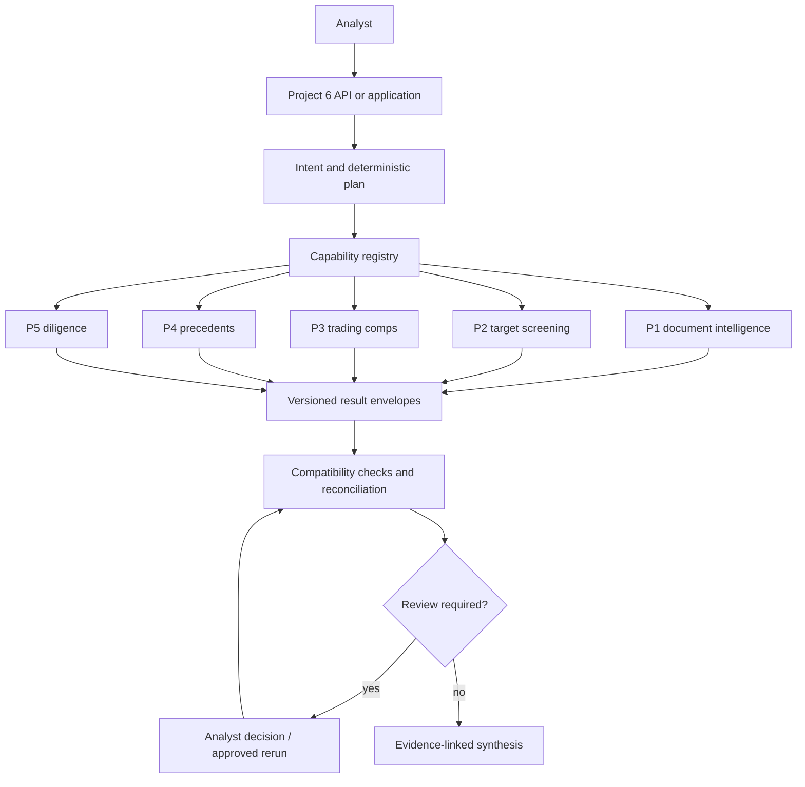
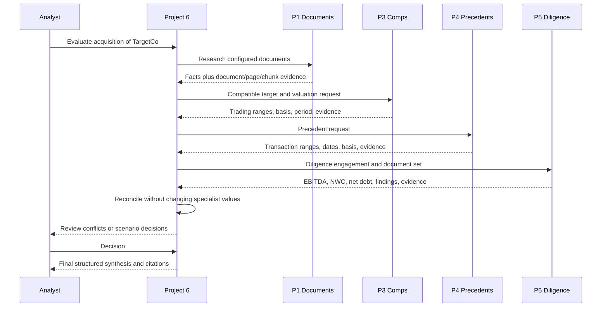

# Portfolio Architecture

## System map

Projects 1–5 own their domain logic. Project 6 owns routing, dependency planning, adapter
translation, canonical deal state, reconciliation, review, and synthesis. It does not copy
valuation or diligence arithmetic.

## Data and evidence flow

P2 enters before valuation when the request is to source or screen targets. V1 does not
automatically value every screened candidate.

The diagram describes the supported orchestration pattern. Existing native-local specialist
fixtures represent different entities and currencies, so V1 deliberately does not manufacture a
single native TargetCo run from incompatible datasets.

## Contracts

Project 6 translates specialist outputs into `CanonicalEntityReference`, `EvidenceReference`,
`FinancialMetricReference`, `ValuationReference`, and `ProjectResultEnvelope`. Adapters preserve
native IDs and details. They reject incompatible entity, currency, date, evidence-set, or schema
inputs instead of relabeling results.

No repository-wide shared package was introduced. Project 6 is the only active cross-project
consumer, so its boundary contracts provide the needed isolation without forcing specialist
internals into one schema.

## Execution modes

| Mode | Executes | Inputs | Intended use |
| --- | --- | --- | --- |
| Fixture | Project 6 adapter payloads | Synthetic P6 fixtures | Fast graph/API demos and tests |
| Native local | Real P1–P5 services through P6 | Offline specialist fixtures/local files | Contract and integration proof |
| Live provider | Separately supplied provider implementation | External systems | Not included as a default V1 composition |

## AI and deterministic boundaries

AI-assisted components may retrieve, interpret, extract candidates, compare semantic statements,
and draft grounded explanations. Deterministic code owns financial calculations, compatibility
validation, dependency plans, graph transitions, retries, review policy, evidence identifiers,
and output validation. See [AI_DETERMINISTIC_BOUNDARY.md](AI_DETERMINISTIC_BOUNDARY.md).

## Reliability and security boundary

Independent specialist failures remain structured data so unrelated work can complete. Retries
are bounded and intended for transient failures. Checkpoints are trusted and process-local; their
pickle serializer must never accept untrusted or externally persisted bytes. APIs are local V1
services without authentication or tenant isolation and should bind to loopback for demos.
